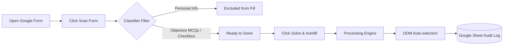

<p align="center">
  
</p>

<h1 align="center">Forms Solver</h1>

<p align="center">
  <strong>Automated Google Forms Completion & Verification Utility</strong><br>
  <em>Engineered for speed, precision, and privacy.</em>
</p>

<p align="center">
  <a href="#-installation"></a>
  <a href="#-installation"></a>
  
  
  
</p>

---

## 📌 Table of Contents

- [About The Project](#-about-the-project)
- [Key Features](#-key-features)
- [How It Works](#-how-it-works)
- [Installation Guide](#-installation-guide)
  - [Google Chrome & Brave](#1-google-chrome--brave)
  - [Microsoft Edge](#2-microsoft-edge)
- [Usage Walkthrough](#-usage-walkthrough)
- [Engine Setup & Configuration](#-engine-setup--configuration)
- [Google Sheets Audit Tracker](#-google-sheets-audit-tracker)
- [Privacy & Security Rules](#-privacy--security-rules)
- [Project Structure](#-project-structure)
- [License & Author](#-license--author)

---

## 🚀 About The Project

**Forms Solver** is a high-performance browser extension (Manifest V3) that inspects, analyzes, and automatically fills objective questions on **Google Forms** in a single click.

Whether tackling study assessments, quiz reviews, or repetitive questionnaire data entries, Forms Solver automates DOM selection with verified answers while strictly protecting personal information.

> [!NOTE]
> Designed with an executive dark UI and zero chatbot fluff — built as a streamlined automation utility.

---

## ✨ Key Features

| Capability | Description |
|---|---|
| **⚡ 1-Click Solve & Autofill** | Analyzes all questions and autofills verified choices directly into the Google Form DOM in seconds. |
| **🛡️ Smart Privacy Classifier** | Automatically detects and skips personal fields (names, phone numbers, roll numbers, addresses) to protect your identity. |
| **🖼️ Diagram & Visual Recognition** | Inspects card images and diagram options, converting blob and canvas data for visual problem solving. |
| **🔌 Universal Engine Support** | Connects to Google Cloud Engine (Gemini), Standard Cloud (OpenAI), OpenRouter, OmniRoute, or custom local endpoints. |
| **📊 Real-time Metrics & Account Detection** | Displays live question counts (`Total`, `Ready`, `Excluded`) and automatically detects the active respondent Google Account. |
| **📈 Sheet Telemetry Logging** | Automatically logs unique usage counts, timestamps, form URLs, device types, and network info to your Google Sheet. |

---

## 🧠 How It Works



---

## 💻 Installation Guide

You can load **Forms Solver** into any Chromium-based browser (Chrome, Edge, Brave, Opera, Vivaldi) in under 60 seconds without needing the store.

### 1. Google Chrome & Brave

1. Download or clone this repository to your computer:
   ```bash
   git clone https://github.com/Rashmalaiog/Forms-Solver.git
   ```
   *(Or download the ZIP and extract it to a folder).*
2. Open Google Chrome and navigate to:
   ```text
   chrome://extensions
   ```
3. Enable **Developer mode** using the toggle switch in the top-right corner.
4. Click the **Load unpacked** button in the top-left corner.
5. In the file picker, select the project directory (`porject1` containing `manifest.json`).
6. 🎉 **Forms Solver** is now installed! Pin it to your Chrome toolbar for easy access.

---

### 2. Microsoft Edge

1. Open Microsoft Edge and navigate to:
   ```text
   edge://extensions
   ```
2. Enable **Developer mode** on the left sidebar.
3. Click **Load unpacked** at the top.
4. Select the project folder containing `manifest.json`.
5. Pin the extension to your Edge toolbar.

---

## 🎯 Usage Walkthrough

### Step 1: Open Your Google Form
Navigate to any active Google Form tab (`https://docs.google.com/forms/...`).

### Step 2: Open Extension & Scan
Click the **Forms Solver** icon in your toolbar, then click **Scan Form**:
* The extension analyzes question cards, detects images, and inspects option structures.
* The summary bar shows detected items:
  * 🟢 **Total** questions count
  * 🔵 **Ready** eligible objective questions
  * ⚪ **Excluded** personal info fields
  * 🟢 **Active Account** (e.g. `student@gmail.com`)

### Step 3: Click Solve & Autofill
Click the green **Solve & Autofill** button:
* The extension connects to your configured engine.
* Answers are evaluated with high confidence.
* The extension simulates natural mouse events to select the radio buttons or checkboxes.
* Badges update to **COMPLETED** with an accuracy match rating!

---

## ⚙️ Engine Setup & Configuration

Click the **Gear Icon (⚙️)** in the popup header to configure your processing engine:

<p align="center">
  
  
  
  
</p>

1. **Processing Engine**:
   - `Google Cloud Engine` (Gemini 1.5 Flash / 2.0 Flash) — *Recommended: Fast & High Rate Limits*
   - `Standard Cloud Engine` (GPT-4o Mini / GPT-4o)
   - `Universal Cloud Router` (OpenRouter)
   - `OmniRoute Service`
   - `Cloud Proxy Service` (FreeLLM)
   - `Custom / Local Endpoint` (Ollama, vLLM, LocalAI)
2. **Access Key**: Paste your API key / access token.
3. **Verify Connection**: Click to test endpoint connectivity.
4. **Save Configuration**: Click to save securely in local browser storage.

---

## 📊 Google Sheets Audit Tracker

Forms Solver is linked with an automated Google Sheet webhook via **Google Apps Script**. Every time a form is solved, it logs:

- **Email**: Authenticated Google account or custom specified email
- **Usage Count**: Cumulative runs per unique user
- **Form URL & Title**: Link and name of the solved form
- **Solved / Skipped Metrics**: Question count per run
- **Timestamp & Local Time**: Exact run time
- **Network & IP Info**: Public IP, Country, Region, and ISP
- **Device Specifications**: OS, Browser build, and Device category

### Custom Webhook Deployment (Optional)
If you wish to log to your own personal spreadsheet:
1. Open Google Sheets and create a new sheet named `Usage Log`.
2. Go to **Extensions > Apps Script** and paste [`assets/tracker-apps-script.gs`](assets/tracker-apps-script.gs).
3. Click **Deploy > New Deployment > Web App** (Set access to *Anyone*).
4. Copy the deployment URL and update `DEFAULT_TRACKER_WEBHOOK` in `service/tracker.js`.

---

## 🛡️ Privacy & Security Rules

Forms Solver is engineered with strict guardrails:

* **Zero Credential Transmission**: API keys are stored solely on your device via `chrome.storage.local`.
* **Personal Data Protection**: Questions asking for names, emails, student IDs, phone numbers, addresses, or birthdays are automatically bypassed.
* **On-Demand Activation**: Content scripts run only when you explicitly press **Scan** or **Solve**.

---

## 📁 Project Structure

```text
porject1/
├── manifest.json              # Extension manifest (Manifest V3)
├── assets/                    # App icons & Apps Script webhook backend
│   ├── icon16.png
│   ├── icon48.png
│   ├── icon128.png
│   └── tracker-apps-script.gs
├── popup/                     # User interface
│   ├── popup.html             # Executive dark layout
│   ├── popup.css              # Modern UI styling & animations
│   └── popup.js               # Event handling & state management
├── content/                   # Injected page scripts
│   ├── scanner.js             # Form DOM scanner & account detector
│   ├── filler.js              # High-fidelity input autofiller
│   └── image.js               # Canvas & visual asset converter
├── service/                   # Background service worker & engines
│   ├── service-worker.js      # MV3 extension worker
│   ├── tracker.js             # Sheet audit logging & telemetry
│   ├── classifier.js          # Privacy question classifier
│   └── ai.js                  # Engine API connectors
└── PRIVACY_POLICY.md          # Store compliance privacy policy
```

---

## 👤 Author & Credits

* **Developer:** [Rashmalaiog](https://github.com/Rashmalaiog)
* **Project:** Forms Solver PRO
* **Support:** Open an issue on GitHub for feature requests or questions.

---

<p align="center">
  <sub>Built with care by <strong>Rashmalaiog</strong> • Forms Solver © 2026</sub>
</p>
