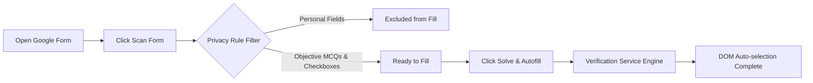

<p align="center">
  
</p>

<h1 align="center">Forms Solver</h1>

<p align="center">
  <strong>Automated Google Forms Completion & Verification Utility</strong><br>
  <em>Engineered for speed, efficiency, and accurate form autofilling.</em>
</p>

<p align="center">
  <a href="#-installation-guide"></a>
  <a href="#-installation-guide"></a>
  
  
  
</p>

---

## 📌 Table of Contents

- [About The Project](#-about-the-project)
- [Key Features](#-key-features)
- [How It Works](#-how-it-works)
- [Installation Guide](#-installation-guide)
  - [Google Chrome & Brave](#1-google-chrome--brave)
  - [Microsoft Edge](#2-microsoft-edge)
- [Usage Walkthrough](#-usage-walkthrough)
- [Service & Engine Configuration](#-service--engine-configuration)
- [Privacy & Security Guardrails](#-privacy--security-guardrails)
- [Project Directory Structure](#-project-directory-structure)
- [Author & Credits](#-author--credits)

---

## 🚀 About The Project

**Forms Solver** is a high-performance browser extension (Manifest V3) that inspects, analyzes, and automatically fills objective questions on **Google Forms** in a single click.

Whether reviewing quizzes, auditing study forms, or processing repetitive multi-choice questionnaires, Forms Solver automates selection directly inside the Google Form DOM with verified answers while safeguarding personal information.

> [!NOTE]
> Engineered with a professional, dark enterprise interface — focused entirely on reliable form automation with zero unnecessary complexity.

---

## ✨ Key Features

| Capability | Description |
|---|---|
| **⚡ 1-Click Form Autofill** | Parses question structures and automatically selects verified options directly in the Google Form DOM in seconds. |
| **🛡️ Smart Privacy Filter** | Automatically detects and skips personal identification fields (names, phone numbers, roll numbers, addresses) to protect your identity. |
| **📐 Diagram & Visual Input Inspection** | Inspects question cards and diagram options, converting visual data for accurate problem matching. |
| **🔌 Multi-Service Engine Compatibility** | Connects to standard cloud verification services, high-speed routing engines, or local custom endpoints. |
| **📊 Real-time Form Audit & Account Display** | Displays live question metrics (`Total`, `Ready`, `Excluded`) and shows the active respondent Google Account session. |
| **🎯 Multiple Question Types** | Full support for Single-Choice (Radio Buttons), Multi-Choice (Checkboxes), and Image-based question cards. |

---

## 🧠 How It Works



---

## 💻 Installation Guide

You can load **Forms Solver** into any Chromium-based browser (Chrome, Edge, Brave, Opera, Vivaldi) in under 60 seconds:

### 1. Google Chrome & Brave

1. Download or clone this repository to your computer:
   ```bash
   git clone https://github.com/Rashmalaiog/Forms-Solver.git
   ```
   *(Or download the ZIP and extract it to a folder).*
2. Open your browser and navigate to:
   ```text
   chrome://extensions
   ```
3. Enable **Developer mode** using the toggle switch in the top-right corner.
4. Click the **Load unpacked** button in the top-left corner.
5. In the file picker, select the project directory containing `manifest.json`.
6. 🎉 **Forms Solver** is now installed! Pin it to your browser toolbar for quick access.

---

### 2. Microsoft Edge

1. Open Microsoft Edge and navigate to:
   ```text
   edge://extensions
   ```
2. Enable **Developer mode** on the left sidebar.
3. Click **Load unpacked** at the top.
4. Select the project folder containing `manifest.json`.
5. Pin the extension to your Edge toolbar.

---

## 🎯 Usage Walkthrough

### Step 1: Open Your Google Form
Navigate to any active Google Form tab (`https://docs.google.com/forms/...`).

### Step 2: Open Extension & Scan
Click the **Forms Solver** icon in your toolbar, then click **Scan Form**:
* The extension inspects question cards, detects images, and analyzes option choices.
* The summary bar displays detected items:
  * ⚪ **Total** question cards found
  * 🔵 **Ready** eligible objective questions
  * ⚪ **Excluded** personal info fields
  * 🟢 **Active Account** (e.g. `student@gmail.com`)

### Step 3: Click Solve & Autofill
Click the green **Solve & Autofill** button:
* The extension connects to your configured processing engine.
* Verified answers are matched with high confidence.
* The extension automatically selects the correct radio button or checkbox options in the page.
* Badges update to **COMPLETED** with an accuracy match rating!

---

## ⚙️ Service & Engine Configuration

Click the **Gear Icon (⚙️)** in the popup header to configure your processing service:

1. **Processing Engine**:
   - `Google Cloud Engine` — *Fast & high-throughput cloud processing*
   - `Standard Cloud Engine` — *Standard processing server*
   - `Universal Cloud Router` — *High-availability routing proxy*
   - `OmniRoute Service` — *Multi-route engine connection*
   - `Cloud Proxy Service` — *Public service proxy*
   - `Custom / Local Endpoint` — *Self-hosted private server or local host*
2. **Access Key**: Paste your service access token or API key.
3. **Verify Connection**: Click to verify server connectivity.
4. **Save Configuration**: Click to save securely in local browser storage.

---

## 🛡️ Privacy & Security Guardrails

Forms Solver is designed with privacy-first principles:

* **Zero Credential Sharing**: All access tokens and engine configurations are stored strictly on your local device via `chrome.storage.local`.
* **Automatic Personal Data Protection**: Questions asking for names, emails, student IDs, phone numbers, or addresses are automatically excluded from automated autofilling.
* **On-Demand Execution**: Scripts activate solely when you press **Scan** or **Solve & Autofill** — zero background tracking when closed.

---

## 📁 Project Directory Structure

```text
porject1/
├── manifest.json              # Extension manifest (Manifest V3)
├── assets/                    # Extension visual assets
│   ├── icon16.png
│   ├── icon48.png
│   └── icon128.png
├── popup/                     # Extension user interface
│   ├── popup.html             # Executive dark layout
│   ├── popup.css              # Modern UI styling & animations
│   └── popup.js               # Event handling & state management
├── content/                   # Injected page scripts
│   ├── scanner.js             # Form DOM scanner & account detector
│   ├── filler.js              # Input auto-selection controller
│   └── image.js               # Canvas & visual asset converter
├── service/                   # Background service worker & engine connectors
│   ├── service-worker.js      # MV3 extension worker
│   ├── tracker.js             # Session & count manager
│   ├── classifier.js          # Privacy rule filter
│   └── ai.js                  # Processing engine connector
└── PRIVACY_POLICY.md          # Compliance privacy policy
```

---

## 👤 Author & Credits

* **Developer:** [Rashmalaiog](https://github.com/Rashmalaiog)
* **Project:** Forms Solver PRO
* **Support:** Open an issue on GitHub for feature requests or questions.

---

<p align="center">
  <sub>Built with care by <strong>Rashmalaiog</strong> • Forms Solver © 2026</sub>
</p>
